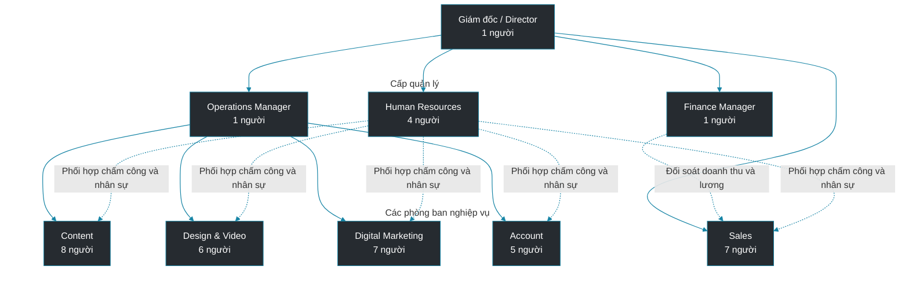
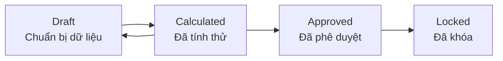

# HỒ SƠ CÔNG TY VÀ QUY CHẾ VẬN HÀNH – HNQ MEDIA

| Thông tin | Nội dung |
|---|---|
| Tên công ty | **Công ty TNHH Truyền thông HNQ** |
| Tên thương hiệu | **HNQ Media** |
| Lĩnh vực | Digital Marketing, truyền thông và sản xuất nội dung số |
| Mô hình kinh doanh | Cung cấp dịch vụ cho doanh nghiệp (B2B) |
| Trụ sở | Thành phố Hồ Chí Minh, Việt Nam |
| Quy mô nhân sự | **40 nhân viên** |
| Hệ thống quản lý nội bộ | **HRFlow – Enterprise Human Resource & Automated Payroll System** |
| Thời gian áp dụng chính sách nội bộ | Từ ngày **01/07/2026** |
| Kỳ lương | Theo tháng dương lịch |
| Đơn vị tiền tệ, múi giờ | VND; Asia/Ho_Chi_Minh |

## 1. Giới thiệu công ty

HNQ Media là doanh nghiệp cung cấp dịch vụ truyền thông và tiếp thị số cho các tổ chức, cửa hàng và doanh nghiệp vừa và nhỏ tại Việt Nam. Công ty đảm nhận từ việc tư vấn chiến lược, sáng tạo nội dung, thiết kế hình ảnh đến triển khai quảng cáo, theo dõi hiệu quả và chăm sóc khách hàng sau dự án.

Tên **HNQ** được ghép từ tên năm thành viên sáng lập trong mô hình công ty: **H** (Hân, Hoa, Hiếu), **N** (Ngân), **Q** (Quan). Công ty định hướng hoạt động theo ba giá trị: **Sáng tạo – Kết nối – Phát triển** (*Create – Connect – Grow*).

### 1.1. Dịch vụ kinh doanh

| Mã | Nhóm dịch vụ | Sản phẩm/kết quả giao cho khách hàng | Bộ phận phụ trách chính |
|---|---|---|---|
| DV01 | Quản trị nội dung mạng xã hội | Kế hoạch bài đăng, nội dung, lịch đăng, báo cáo | Content |
| DV02 | Thiết kế truyền thông | Banner, bộ nhận diện chiến dịch, video ngắn, ấn phẩm quảng cáo | Design & Video |
| DV03 | Quảng cáo trực tuyến | Thiết lập và quản lý quảng cáo Google/Meta, báo cáo hiệu quả | Digital Marketing |
| DV04 | SEO và tối ưu kênh số | Phân tích từ khóa, nội dung SEO, báo cáo thứ hạng/lưu lượng | Digital Marketing & Content |
| DV05 | Quản lý khách hàng và chiến dịch | Tiếp nhận yêu cầu, điều phối tiến độ, nghiệm thu và chăm sóc khách hàng | Account |
| DV06 | Tư vấn gói truyền thông | Khảo sát nhu cầu, báo giá, ký kết hợp đồng dịch vụ | Sales phối hợp Account |

**Nguồn doanh thu của công ty** gồm phí tư vấn, phí sản xuất nội dung/thiết kế, phí quản lý quảng cáo, phí triển khai chiến dịch và phí dịch vụ định kỳ. Khoản khách hàng chuyển cho công ty **chỉ để chi hộ ngân sách chạy quảng cáo** không phải doanh thu dịch vụ dùng để tính KPI Sales.

### 1.2. Quy trình kinh doanh tổng quát

1. **Sales** tiếp cận khách hàng, ghi nhận nhu cầu và đề xuất gói dịch vụ.
2. **Account** phối hợp bộ phận chuyên môn xác định phạm vi, tiến độ, giá và các đầu việc.
3. Khách hàng ký hợp đồng; **Sales** được ghi nhận là người phụ trách doanh thu theo hồ sơ hợp đồng.
4. **Content, Design và Digital Marketing** thực hiện công việc theo kế hoạch; **Account** theo dõi tiến độ, liên hệ khách hàng.
5. Khách hàng xác nhận kết quả/nghiệm thu theo từng giai đoạn hoặc theo hợp đồng.
6. Bộ phận phụ trách tài chính xác nhận khoản tiền khách đã thanh toán.
7. **Sales Manager và HR** đối soát doanh thu hợp lệ, KPI và hoa hồng để chuyển dữ liệu sang bảng lương.

HRFlow quản lý **nhân sự và tiền lương**, không thay thế phần mềm CRM, quản lý dự án hoặc kế toán. Các khoản doanh thu và nghiệm thu có thể được nhập vào HRFlow dưới dạng **bảng kết quả đã xác nhận**, có chứng từ tham chiếu.

## 2. Cơ cấu tổ chức và sơ đồ công ty

HNQ Media có **7 phòng ban, 40 người**, gồm 3 người ở bộ phận điều hành và 37 người thuộc 6 bộ phận nghiệp vụ.

*Đường liền thể hiện quan hệ quản lý; đường nét đứt thể hiện phối hợp nghiệp vụ. Các nhóm chuyên môn đều có trưởng bộ phận trực tiếp. Sơ đồ sử dụng cú pháp Mermaid để hiển thị trong trình xem Markdown hỗ trợ Mermaid, như GitHub.*

| Phòng ban | Nhân sự | Cơ cấu | Nhiệm vụ chính |
|---|---:|---|---|
| Management | 3 | 1 Giám đốc, 1 Operations Manager, 1 Finance Manager | Điều hành, vận hành, ngân sách và kiểm soát tài chính |
| Content | 8 | 1 Content Lead, 7 Content Executive | Nội dung quảng cáo, bài đăng, SEO content |
| Design & Video | 6 | 1 Design Lead, 5 Designer/Video Editor | Thiết kế đồ họa, video và ấn phẩm |
| Digital Marketing | 7 | 1 Digital Lead, 6 SEO/Ads Specialist | Quảng cáo, phân tích dữ liệu, SEO |
| Account | 5 | 1 Account Lead, 4 Account Executive | Chăm sóc khách, hợp đồng dịch vụ, nghiệm thu |
| Sales | 7 | 1 Sales Manager, 6 Sales Executive | Tìm khách hàng, doanh số và hợp đồng mới |
| Human Resources | 4 | 1 HR Lead, 3 HR Executive | Hồ sơ, hợp đồng lao động, chấm công, lương và chế độ |
| **Tổng cộng** | **40** | | |

### 2.1. Nguyên tắc quản lý nhân sự

- Mỗi nhân viên có **mã nhân viên duy nhất**, họ tên, phòng ban, chức danh, cấp quản lý, loại hợp đồng và trạng thái làm việc.
- Mỗi nhân viên trực thuộc một phòng ban tại một thời điểm. Việc chuyển phòng ban/chức danh có **ngày hiệu lực** và lưu lịch sử.
- Trưởng phòng quản lý công việc và duyệt yêu cầu của nhân viên thuộc phạm vi phụ trách; Operations Manager quản lý và duyệt đơn của các Lead Content, Design, Digital và Account; Giám đốc quản lý và duyệt đơn của Sales Manager, Operations Manager, Finance Manager và HR Lead. Giám đốc gửi đơn cho HR Lead duyệt theo tuyến một cấp đã thống nhất tại Mục 4.
- Không cho phép một nhân viên tự phê duyệt yêu cầu do chính mình gửi. HNQ áp dụng tuyến duyệt nội bộ một cấp như sau: nhân viên Content/Design/Digital/Account do Lead trực tiếp duyệt; nhân viên Sales do Sales Manager duyệt; nhân viên HR do HR Lead duyệt; các Lead và Sales Manager do Operations Manager hoặc Giám đốc theo tuyến quản lý nêu trên duyệt; Operations Manager và Finance Manager do Giám đốc duyệt; HR Lead do Giám đốc duyệt; đơn của Giám đốc do HR Lead duyệt. Nếu người duyệt chính vắng mặt hoặc có xung đột lợi ích, dùng người dự phòng được cấu hình trước: Operations Manager thay Lead các phòng nghiệp vụ, Giám đốc thay Sales Manager/HR Lead, và HR Executive được HR Lead chỉ định trước thay HR Lead khi duyệt đơn của Giám đốc. Người dự phòng chỉ duyệt trong đúng phạm vi đơn được ủy quyền và không được tự duyệt đơn của mình.

## 3. Loại nhân sự và trạng thái làm việc

| Nhóm nhân sự | Số lượng mẫu | Đặc điểm | Quy tắc trả thu nhập |
|---|---:|---|---|
| Nhân viên chính thức toàn thời gian | 34 | Làm theo lịch hành chính 40 giờ/tuần | Lương tháng theo công, phụ cấp, OT và khoản thưởng đủ điều kiện |
| Nhân viên bán thời gian | 3 | Làm theo lịch riêng 20 giờ/tuần | Lương tháng theo giờ chuẩn của lịch bán thời gian |
| Nhân viên thử việc | 2 | Làm theo hợp đồng/thỏa thuận thử việc | Lương thử việc và quyền lợi theo thỏa thuận hợp lệ |
| Thực tập sinh | 1 | Thực tập có kế hoạch và người hướng dẫn | Trợ cấp theo thỏa thuận; nếu thực tế là quan hệ lao động thì xử lý theo loại hợp đồng tương ứng |
| **Tổng** | **40** | | |

Tài khoản/hồ sơ có các trạng thái: **Onboarding** (đang tiếp nhận), **Active** (đang làm việc), **On Leave** (tạm nghỉ theo chế độ), **Terminated** (đã kết thúc làm việc). Khi nghỉ việc, tài khoản được vô hiệu hóa theo ngày hiệu lực nhưng **không xóa hồ sơ, chấm công, phiếu lương và lịch sử đã phát sinh**.

Đây là **trạng thái nghiệp vụ** của HNQ. Trong migration hiện tại, `employee.status` mới giới hạn `ACTIVE/TERMINATED`, còn trạng thái tài khoản dùng `is_active`; `Onboarding` và `On Leave` cần được biểu diễn bằng quy trình/hợp đồng và dữ liệu nghỉ phép, hoặc được Ngân thống nhất bổ sung vào mô hình nếu cần truy vấn trực tiếp.

## 4. Vai trò sử dụng hệ thống HRFlow

**Chức danh công việc** và **vai trò truy cập hệ thống** là hai thuộc tính độc lập. HRFlow sử dụng đúng **4 vai trò**:

| Vai trò | Người sử dụng | Phạm vi chức năng |
|---|---|---|
| **Employee** | Nhân viên thông thường | Xem/cập nhật thông tin được phép của mình; check-in/out; tạo đơn nghỉ phép; đăng ký OT đã công bố; xem công và phiếu lương của mình |
| **Manager** | Người được bổ nhiệm quản lý trực tiếp | Quyền cá nhân của Employee và duyệt/từ chối đơn, xem thông tin công của nhân viên thuộc quyền; không mặc nhiên xem phiếu lương của cấp dưới |
| **HR** | Nhân sự được giao nghiệp vụ | Quản lý hồ sơ và hợp đồng; rà soát chấm công, phép, OT; chuẩn bị, tính, rà soát và xuất bảng lương theo thẩm quyền |
| **Admin** | Tài khoản quản trị kỹ thuật độc lập, không phải chức danh nhân sự | Tạo/vô hiệu hóa tài khoản, quản lý vai trò và cấu hình kỹ thuật; giám sát nhật ký; không mặc định phê duyệt PTO/OT, tính hoặc duyệt lương, xem toàn bộ phiếu lương hay thay đổi dữ liệu nhân sự nhạy cảm |

### 4.1. Ánh xạ chức danh sang vai trò hệ thống

Chức danh trong bảng dưới đây là **chức danh công việc**; vai trò HRFlow là **vai trò truy cập** được lưu cho tài khoản. Vai trò không tự thay đổi theo loại nhân sự (full-time, part-time, thử việc hoặc thực tập), mà căn cứ vào chức danh, nhiệm vụ thực tế và phạm vi được giao.

| Phòng ban | Chức danh | Số lượng | Vai trò HRFlow | Ghi chú phạm vi quyền |
|---|---|---:|---|---|
| Management | Giám đốc | 1 | **Manager** | Quản lý trực tiếp và phê duyệt PTO/OT của Sales Manager, Operations Manager, Finance Manager và HR Lead theo tuyến một cấp.  |
| Management | Operations Manager | 1 | **Manager** | Quản lý trực tiếp các Lead Content, Design, Digital và Account; chỉ xem công và duyệt đơn trong phạm vi cấp dưới trực tiếp. |
| Management | Finance Manager | 1 | **Manager** | Phạm vi Manager theo nhân viên được gán trực tiếp; không mặc nhiên quản lý hoặc duyệt đơn của các phòng ban khác. |
| Content | Content Lead | 1 | **Manager** | Quản lý trực tiếp 7 Content Executive; duyệt PTO/OT của nhóm Content. |
| Content | Content Executive | 7 | **Employee** | Chỉ truy cập dữ liệu của chính mình; gửi PTO/OT cho Content Lead. |
| Design & Video | Design Lead | 1 | **Manager** | Quản lý trực tiếp 5 Designer/Video Editor; duyệt PTO/OT của nhóm Design & Video. |
| Design & Video | Designer/Video Editor | 5 | **Employee** | Chỉ truy cập dữ liệu của chính mình; gửi PTO/OT cho Design Lead. |
| Digital Marketing | Digital Lead | 1 | **Manager** | Quản lý trực tiếp 6 SEO/Ads Specialist; duyệt PTO/OT của nhóm Digital Marketing. |
| Digital Marketing | SEO/Ads Specialist | 6 | **Employee** | Chỉ truy cập dữ liệu của chính mình; gửi PTO/OT cho Digital Lead. |
| Account | Account Lead | 1 | **Manager** | Quản lý trực tiếp 4 Account Executive; duyệt PTO/OT của nhóm Account. |
| Account | Account Executive | 4 | **Employee** | Chỉ truy cập dữ liệu của chính mình; gửi PTO/OT cho Account Lead. |
| Sales | Sales Manager | 1 | **Manager** | Quản lý trực tiếp 6 Sales Executive; duyệt PTO/OT của nhóm Sales; không tự duyệt đơn của mình. |
| Sales | Sales Executive | 6 | **Employee** | Chỉ truy cập dữ liệu của chính mình; hoa hồng/KPI theo chính sách Sales; gửi PTO/OT cho Sales Manager. |
| Human Resources | HR Lead | 1 | **HR** | Quản lý nghiệp vụ HR và 3 HR Executive; duyệt đơn của nhân viên không có Manager; duyệt đơn của Giám đốc theo tuyến đặc biệt; không tự duyệt đơn của mình. |
| Human Resources | HR Executive | 3 | **HR** | Xử lý nghiệp vụ HR trong phạm vi được giao; gửi PTO/OT cho HR Lead hoặc tuyến thay thế đã cấu hình; không tự có quyền Admin. |
| **Tổng cộng** |  | **40** |  | Không có vai trò hệ thống thứ năm. |

Trong database hiện tại, `app_user.role` là một trường đơn và migration chưa có bảng `roles`/`user_roles`; do đó chưa thể khẳng định một tài khoản có nhiều role đồng thời. HR Lead được dùng role **HR** kèm quyền phê duyệt theo tuyến nêu trên, không tạo role mới và không mặc định gán thêm **Manager**.

Tài khoản **Admin** là tài khoản quản trị kỹ thuật độc lập, không phải một chức danh nhân sự và không thuộc danh sách 40 nhân sự. Migration hiện tại cho phép `app_user.employee_id` là `NULL`, nên về mặt cấu trúc có thể tạo tài khoản Admin không liên kết hồ sơ `employee`. Tuy nhiên, dữ liệu mẫu hiện tại đang gắn tài khoản Admin với hồ sơ nhân viên số 1; Ngân cần tách liên kết này khi triển khai phương án 2, đồng thời bảo đảm tài khoản Admin không được tham gia tuyến duyệt PTO/OT hoặc tự động nhận quyền nghiệp vụ của Giám đốc. Việc tách tài khoản không làm tăng quy mô nhân sự lên 41 người.

Quyền dữ liệu và quyền phê duyệt là hai lớp riêng: Manager chỉ có phạm vi nhân viên có `manager_id` trực tiếp bằng mình hoặc trường hợp được ủy quyền hợp lệ; HR xử lý phạm vi nghiệp vụ nhân sự theo RBAC; Employee chỉ xem dữ liệu của mình; Admin chỉ quản trị kỹ thuật theo quyền được cấp. Việc được gán chức danh Giám đốc, Manager hoặc HR không tự động cấp quyền Admin, quyền xem toàn bộ dữ liệu lương hoặc quyền duyệt ngoài tuyến. Admin không tham gia tuyến duyệt PTO/OT. Các tuyến dự phòng khi người duyệt vắng mặt thực hiện theo bảng phê duyệt tại Mục 4 và phải được cấu hình trong RBAC/database.

Quy trình duyệt PTO/OT sử dụng **một cấp phê duyệt** theo tuyến cụ thể tại Mục 2.1. Đối với nhân viên không có Manager trực tiếp, HR Lead xử lý; đối với đơn của HR Lead, Giám đốc xử lý; đối với đơn của Giám đốc, HR Lead xử lý. Khi người duyệt vắng mặt, chỉ người dự phòng đã được cấu hình trước mới được thay thế. Không tự duyệt, không chuyển tiếp qua nhiều cấp. Mọi thay đổi có người thực hiện, thời gian và lý do. Chi tiết phạm vi API trong [`docs/rbac-matrix.md`](./rbac-matrix.md); việc cấu hình người duyệt dự phòng cần Ngân bổ sung vào RBAC/database nếu hệ thống chưa hỗ trợ.

| Người gửi đơn | Người duyệt chính | Người thay thế khi vắng mặt/không thể xử lý |
|---|---|---|
| Nhân viên Content/Design/Digital/Account | Lead trực tiếp | Operations Manager |
| Nhân viên Sales | Sales Manager | Giám đốc |
| Nhân viên HR | HR Lead | Giám đốc |
| Lead Content/Design/Digital/Account | Operations Manager | Giám đốc |
| Sales Manager, Operations Manager, Finance Manager | Giám đốc | Không có tuyến thay thế mặc định; HR Lead chỉ tiếp nhận và chuyển xử lý, không tự duyệt thay Giám đốc |
| HR Lead | Giám đốc | Finance Manager được Giám đốc chỉ định trước |
| Giám đốc | HR Lead | HR Executive được HR Lead chỉ định trước |

Người duyệt thay thế thực hiện đúng một quyết định **Approve/Reject** và ghi lý do/ủy quyền vào approval log. Nếu người gửi đơn đồng thời là người duyệt chính hoặc thay thế, hệ thống phải từ chối thao tác tự duyệt và chuyển cho tuyến dự phòng tiếp theo đã cấu hình.

## 5. Lịch làm việc và chấm công

### 5.1. Giờ làm việc

| Nội dung | Quy định |
|---|---|
| Ngày làm việc | **Thứ Hai đến thứ Sáu** |
| Ngày nghỉ hằng tuần | **Thứ Bảy và Chủ Nhật** |
| Buổi sáng | **08:30–12:00** (3 giờ 30 phút) |
| Nghỉ trưa | **12:00–13:00** (không tính giờ làm) |
| Buổi chiều | **13:00–17:30** (4 giờ 30 phút) |
| Tổng giờ công chuẩn | **8 giờ/ngày, 40 giờ/tuần** |
| Nhân viên part-time | **08:30–12:30, thứ Hai đến thứ Sáu**, 4 giờ/ngày, 20 giờ/tuần trong dữ liệu mẫu |
| Ngày lễ/Tết | Nghỉ theo lịch đã công bố và chế độ áp dụng; không tính là ngày vắng mặt không phép |

**Chính sách HNQ:** ngày công chuẩn của tháng là số ngày phải làm theo lịch của nhân viên trong kỳ, đã loại ngày lễ nghỉ hưởng lương; không mặc định mọi tháng là 22 hoặc 26 công. Tổng giờ chuẩn là tổng thời lượng các ca làm trong kỳ; nhân viên part-time dùng **giờ chuẩn riêng**.

**Điểm cần thống nhất trước khi tính lương:** [`docs/payroll_rules.md`](./payroll_rules.md) và migration mẫu hiện dùng tham số `standard_working_days = 22`, đồng thời bảng `payroll_period` có mặc định 22. Vì vậy, cho đến khi Hiếu cập nhật công thức/tham số, không được coi quy tắc theo lịch ở trên là đã được engine áp dụng tự động. Kỳ lương phải lưu rõ giá trị ngày công chuẩn được chốt.

### 5.2. Quy trình chấm công

1. Nhân viên ghi nhận **check-in** khi bắt đầu ca và **check-out** khi kết thúc ca.
2. Hệ thống lưu thời gian thực tế, đối chiếu giờ bắt đầu/kết thúc và thời gian nghỉ trưa.
3. Hệ thống tính số giờ làm thường được xác nhận, số phút đi trễ/về sớm và trường hợp dữ liệu thiếu.
4. Nhân viên xem công của mình; nếu có sai sót thì gửi yêu cầu giải trình/chỉnh công.
5. Manager xác nhận dữ liệu thực tế; HR rà soát, chốt dữ liệu trước kỳ lương.
6. Bảng công kỳ đã khóa không được sửa trực tiếp; nếu phát hiện sai phải đi theo điều chỉnh kỳ sau.

### 5.3. Quy tắc tính công

- **Đủ công:** 8 giờ được trả lương hợp lệ/ngày với nhân viên full-time, gồm giờ làm việc xác nhận và giờ nghỉ hưởng lương hợp lệ. Part-time áp dụng giờ ca tương ứng.
- **Đi muộn/về sớm:** hệ thống ghi nhận số phút thực tế từ phút đầu tiên; không áp dụng khoản phạt tiền cố định. Thời gian thiếu được đối chiếu với nghỉ có lương, giải trình đã xác nhận và giờ thực tế trước khi tính tiền công.
- **Đến sớm/về muộn:** không tự động là OT; chỉ tính OT khi xác nhận việc làm thêm thực tế và điều kiện nghiệp vụ.
- **Thiếu check-in hoặc check-out:** đặt trạng thái **Needs Review**, không tự tính 0 công. Nhân viên phải giải trình và bổ sung minh chứng để Manager/HR xác nhận.
- **Chấm công trùng:** chỉ tính mỗi khoảng thời gian hợp lệ một lần, loại khoảng chồng lặp.
- **Đi công tác/làm việc bên ngoài:** lịch và minh chứng được Manager phê duyệt; giờ đủ điều kiện được ghi nhận như công thường.
- **Ngày nghỉ/đổi lịch giữa kỳ:** xét lịch cá nhân có hiệu lực tại ngày đó; không áp dụng lịch mới ngược trở về quá khứ.

| Tình huống | Giờ công được trả | Cách xử lý |
|---|---:|---|
| Làm 08:30–12:00 và 13:00–17:30 | 8 giờ | Đủ 1 công |
| Đi làm 08:40, về 17:30 | 7 giờ 50 phút | Ghi đi trễ 10 phút, xét giải trình |
| Đi làm 08:30, về 17:00 | 7 giờ 30 phút | Ghi về sớm 30 phút |
| Làm 4 giờ và nghỉ phép có lương 4 giờ | 8 giờ | Trừ quỹ phép 0,5 ngày |
| Làm 4 giờ và nghỉ không lương 4 giờ | 4 giờ | 0,5 công tương đương |
| Quên check-out | Chưa chốt | Chờ xác minh và duyệt điều chỉnh |
| Làm thêm 18:00–20:00, đã duyệt và xác nhận | 8 giờ thường + 2 giờ OT | Không đếm OT vào công thường |
| Làm thêm Chủ Nhật | 0 giờ thường + giờ OT hợp lệ | Tính theo loại ngày nghỉ tuần |

## 6. Quy định nghỉ phép và vắng mặt

### 6.1. Các loại nghỉ

| Loại nghỉ | Cách hưởng lương/quỹ phép | Phê duyệt và xử lý |
|---|---|---|
| Nghỉ phép năm | Nghỉ hưởng lương; trừ quỹ phép năm | Manager duyệt; HR theo dõi số dư |
| Nghỉ việc riêng hưởng lương | Theo trường hợp đủ điều kiện; không trừ phép năm | Nhân viên báo/đăng ký và nộp thông tin cần thiết |
| Nghỉ lễ/Tết | Theo lịch nghỉ được hưởng | Tự nhận diện theo lịch, không yêu cầu đơn phép năm |
| Nghỉ không hưởng lương | Không cộng giờ nghỉ vào công hưởng lương | Cần có sự đồng ý theo quy định/thỏa thuận |
| Nghỉ ốm, thai sản | Xử lý theo chế độ áp dụng, không mặc định là phép năm hoặc không lương | HR phân loại và kiểm tra chứng từ |
| Nghỉ chưa được chấp thuận/vắng mặt chưa rõ | Chưa tự kết luận là công hưởng lương | Chờ xác minh, không tự đổi thành nghỉ phép năm |

### 6.2. Chính sách phép năm

- Nhân viên làm đủ 12 tháng trong điều kiện bình thường được **12 ngày phép năm**; làm chưa đủ năm tính tỷ lệ theo thời gian và quy định áp dụng.
- Quỹ phép được theo dõi theo ngày hoặc quy đổi giờ tương ứng với lịch làm việc của từng người. Hỗ trợ nghỉ **0,5 ngày**, **1 ngày** hoặc nhiều ngày liên tục.
- Hệ thống kiểm tra số phép còn lại và các đơn đã được duyệt để ngăn sử dụng trùng. Không cho số dư âm theo chính sách nội bộ thông thường.
- Nghỉ vào ngày không phải ngày làm việc theo lịch không bị trừ phép năm.
- Nhân viên được xem số dư đầu kỳ, phép phát sinh, phép đã sử dụng, phép còn lại và lịch sử điều chỉnh.
- Khi chấm dứt hợp đồng, HR rà soát ngày phép chưa nghỉ để thanh toán trong các trường hợp được áp dụng.

### 6.3. Quy trình nộp đơn

**Nhân viên tạo đơn → Hệ thống kiểm tra ngày/số dư/trùng lịch → Manager hoặc HR có quyền duyệt → Nhân viên nhận kết quả → Dữ liệu được chuyển sang bảng công.**

Trạng thái đơn: **Draft → Pending → Approved / Rejected / Cancelled**. Đơn từ chối có lý do; nhân viên muốn thay đổi đơn đã duyệt phải xin hủy/điều chỉnh, không âm thầm sửa lịch sử. Đơn còn chờ xử lý trước chốt lương được HR nhắc duyệt và giải quyết; không tự tính là nghỉ không lương.

## 7. Quy định tăng ca (OT)

### 7.1. Cách tổ chức OT

HNQ Media không cho nhân viên tự tạo một ca OT tùy ý. Quy trình thống nhất:

1. HR hoặc Manager tạo **lịch OT** gồm ngày, khoảng giờ, công việc, bộ phận/nhân viên được phân công.
2. Lịch được công bố cho nhân viên đủ điều kiện; nhân viên xác nhận đồng ý và đăng ký.
3. Manager trực tiếp (hoặc HR có thẩm quyền thay thế) xét duyệt đơn đăng ký.
4. Nhân viên thực hiện công việc; hệ thống hoặc minh chứng nghiệp vụ ghi nhận giờ OT thực tế.
5. Manager xác nhận số giờ thực hiện; HR kiểm tra và đưa số giờ hợp lệ sang kỳ lương.

**Giờ đăng ký, giờ được duyệt và giờ làm thực tế là ba thông tin khác nhau.** Không trả OT cho giờ chỉ đăng ký nhưng không thực hiện. Nếu được duyệt 3 giờ nhưng xác minh chỉ làm 2 giờ thì ghi nhận và tính 2 giờ. Nếu giờ thực tế vượt giờ được duyệt do yêu cầu công việc, phần vượt phải được Manager/HR xác minh về thời gian, công việc, minh chứng và điều kiện trả OT; kết quả được ghi nhận là phần OT bổ sung được xác nhận hoặc phần chưa đủ căn cứ. Việc chưa có phê duyệt bổ sung tại thời điểm phát sinh không tự động làm mất quyền được thanh toán đối với giờ làm thêm thực tế thuộc diện phải trả lương; ngược lại, giờ không xác minh được hoặc không đáp ứng điều kiện thì không tự động đưa vào lương.

### 7.2. Nguyên tắc trả OT

| Loại thời gian | Nguyên tắc |
|---|---|
| OT ban ngày vào ngày làm việc thường | Ít nhất **150%** đơn giá OT tương ứng |
| OT ban ngày vào ngày nghỉ hằng tuần | Ít nhất **200%** |
| OT ban ngày vào ngày lễ/Tết | Ít nhất **300%**, và các quyền lợi ngày lễ liên quan |
| Giờ làm ban đêm 22:00–06:00 | Tách riêng phần trả thêm theo quy định |
| OT ban đêm | Tách theo ngày và khung giờ, tính các khoản bổ sung theo quy định |

Quản lý giới hạn giờ OT và sự đồng ý của người lao động; công ty áp dụng ngưỡng quản trị nội bộ **không quá 4 giờ OT/ngày đối với ca 8 giờ**, **40 giờ OT/tháng** và theo trần năm áp dụng, nhưng mọi giới hạn vẫn phải được kiểm tra lại theo pháp luật và thỏa thuận lao động có hiệu lực tại thời điểm phát sinh. OT qua 22:00 hoặc qua 00:00 phải chia thành các đoạn giờ chính xác. `payroll_rules.md` quy định phép tính cuối cùng và kiểm soát giới hạn.

Migration hiện có lịch OT và đơn đăng ký, nhưng chưa có trường giờ thực tế/xác nhận hoàn thành, loại ngày và đoạn ban đêm riêng. **[Cần bổ sung hệ thống]** Không tính toàn bộ thời lượng lịch đã công bố là giờ OT trả lương nếu chưa có xác nhận thực tế.

## 8. Chính sách tiền lương và thu nhập

### 8.1. Nguyên tắc chung

- HNQ Media trả lương theo **tháng**, tính dựa trên số giờ công thường được trả trong kỳ. **Lương cơ bản** là mức lương tháng theo chức danh hoặc thỏa thuận, chưa bao gồm OT, phụ cấp, hoa hồng và thưởng.
- **Lương theo công** là khoản lương được xác định từ lương cơ bản và thời gian làm việc cùng thời gian nghỉ hưởng lương hợp lệ trong kỳ. Nhân viên đủ toàn bộ giờ công chuẩn hoặc kết hợp giờ làm với nghỉ hưởng lương hợp lệ sẽ nhận đủ lương cơ bản tháng trong thời gian hợp đồng có hiệu lực.
- **Tổng thu nhập Gross** là lương theo công cộng OT, phụ cấp, hoa hồng, thưởng và các khoản bổ sung đủ điều kiện, trước khi tính các khoản khấu trừ.
- **Lương Net** là số tiền thực nhận sau bảo hiểm người lao động, thuế TNCN, khấu trừ và điều chỉnh hợp lệ.
- Tất cả phòng ban dùng **một cấu trúc tính lương chung**; khác nhau ở mức lương, điều kiện phụ cấp, thưởng, hoa hồng và lịch làm việc.
- Thành phần thu nhập Gross được tính **một lần**, không cộng lại phụ cấp sau khi đã trừ bảo hiểm, thuế.
- Hệ thống lưu mức lương/phụ cấp và ngày bắt đầu có hiệu lực; vào/ra công ty, chuyển chức danh hoặc tăng lương giữa tháng phải tính theo từng giai đoạn.

**Cấu trúc thu nhập:**

`Tổng thu nhập Gross = Lương theo công + Tiền OT + Phụ cấp đủ điều kiện + Hoa hồng + Thưởng được duyệt + Khoản bổ sung khác`

`Lương Net = Gross − Bảo hiểm người lao động − Thuế TNCN − Khấu trừ hợp lệ ± Điều chỉnh được phân loại`

Công thức chi tiết, căn cứ bảo hiểm, tính thuế, làm tròn và điều chỉnh thuộc `payroll_rules.md`. Hoa hồng, thưởng KPI và thu nhập bổ sung chỉ được cộng khi có bản ghi đã duyệt; hiện `payroll_rules.md` mới chốt Gross từ lương theo công, OT và phụ cấp, chưa chốt cách đưa hoa hồng/thưởng vào Gross. **[Cần cập nhật payroll_rules.md trước khi triển khai tự động]** để tránh bỏ sót hoặc tính trùng các khoản này.

### 8.2. Bảng lương cơ bản theo vị trí

Các số dưới đây là **mức lương gốc khi làm đủ công chuẩn** của công ty; không bao gồm phụ cấp, hoa hồng và OT.

| Chức danh | Lương cơ bản/tháng (VND) | Hình thức thu nhập |
|---|---:|---|
| Content Executive | 10.000.000 | Lương tháng + phụ cấp + OT hợp lệ |
| Designer / Video Editor | 11.000.000 | Lương tháng + phụ cấp + OT hợp lệ |
| SEO / Ads Specialist | 12.000.000 | Lương tháng + phụ cấp + OT hợp lệ |
| Account Executive | 11.000.000 | Lương tháng + phụ cấp + OT hợp lệ |
| Sales Executive | 9.000.000 | Lương tháng + phụ cấp + OT + hoa hồng + thưởng KPI |
| HR Executive | 11.000.000 | Lương tháng + phụ cấp + OT hợp lệ |
| Content / Design / Digital / Account / HR Lead | 16.000.000 | Lương tháng + phụ cấp chức vụ + OT hợp lệ |
| Sales Manager | 18.000.000 | Lương tháng + phụ cấp chức vụ; thưởng riêng nếu được duyệt |
| Operations Manager / Finance Manager | 20.000.000 | Lương tháng + phụ cấp chức vụ |
| Giám đốc | 30.000.000 | Thu nhập theo hợp đồng/quyết định bổ nhiệm hợp lệ |
| Part-time (lịch mẫu 20 giờ/tuần) | 5.000.000 | Lương tháng theo lịch riêng + phụ cấp tương ứng |
| Nhân viên thử việc | 85% mức lương chức danh chính thức tương ứng | Theo thời hạn và hợp đồng thử việc cụ thể |
| Thực tập sinh đào tạo | Trợ cấp 4.000.000/tháng | Theo thỏa thuận thực tập thực chất |

**Lưu ý vận hành:** mức 85% là mức chọn cho dữ liệu mô phỏng thử việc, không phải cơ chế tự động áp vào người đã làm việc theo HĐLĐ chính thức. Dữ liệu hợp đồng quyết định căn cứ áp dụng.

### 8.2.1. Bảng tổng hợp chính sách lương theo phòng ban

| Phòng ban | Chức danh hoặc nhóm vị trí | Mức lương cơ bản/tháng | Phụ cấp áp dụng | KPI, hoa hồng hoặc thưởng dự án | Hình thức trả thu nhập |
|---|---|---:|---|---|---|
| Management | Giám đốc; Operations Manager; Finance Manager | 30.000.000; 20.000.000 | Ăn trưa 730.000, gửi xe 200.000, chức vụ 2.000.000; điện thoại 300.000 nếu đủ điều kiện | Thưởng riêng khi có quyết định | Lương theo công + phụ cấp đủ điều kiện + OT/thưởng được duyệt |
| Content | Content Lead; Content Executive | 16.000.000; 10.000.000 | Ăn trưa 730.000, gửi xe 200.000; Lead thêm chức vụ 2.000.000 và điện thoại 300.000 nếu đủ điều kiện | Không có KPI tiền tự động; thưởng dự án theo quyết định | Lương theo công + phụ cấp đủ điều kiện + OT/thưởng dự án được duyệt |
| Design & Video | Design Lead; Designer/Video Editor | 16.000.000; 11.000.000 | Ăn trưa 730.000, gửi xe 200.000; Lead thêm chức vụ 2.000.000 và điện thoại 300.000 nếu đủ điều kiện | Thưởng dự án nếu được phê duyệt | Lương theo công + phụ cấp đủ điều kiện + OT/thưởng dự án được duyệt |
| Digital Marketing | Digital Lead; SEO/Ads Specialist | 16.000.000; 12.000.000 | Ăn trưa 730.000, gửi xe 200.000; Lead thêm chức vụ 2.000.000 và điện thoại 300.000 nếu đủ điều kiện | Thưởng dự án nếu được phê duyệt | Lương theo công + phụ cấp đủ điều kiện + OT/thưởng dự án được duyệt |
| Account | Account Lead; Account Executive | 16.000.000; 11.000.000 | Ăn trưa 730.000, gửi xe 200.000; Lead thêm chức vụ 2.000.000 và điện thoại 300.000 | Thưởng dự án nếu được phê duyệt; không chia hoa hồng Sales | Lương theo công + phụ cấp đủ điều kiện + OT/thưởng dự án được duyệt |
| Sales | Sales Manager; Sales Executive | 18.000.000; 9.000.000 | Ăn trưa 730.000, gửi xe 200.000, điện thoại 300.000; Manager thêm chức vụ 2.000.000 | Sales Executive: hoa hồng 2% doanh thu đủ điều kiện và thưởng KPI 1.500.000 khi đạt chỉ tiêu; Manager thưởng riêng nếu được duyệt | Lương theo công + phụ cấp đủ điều kiện + OT/hoa hồng/thưởng KPI được duyệt |
| Human Resources | HR Lead; HR Executive | 16.000.000; 11.000.000 | Ăn trưa 730.000, gửi xe 200.000; Lead thêm chức vụ 2.000.000 và điện thoại 300.000 nếu đủ điều kiện | Không có hoa hồng; thưởng theo quyết định | Lương theo công + phụ cấp đủ điều kiện + OT/thưởng được duyệt |

Part-time áp dụng lương tháng theo lịch riêng **5.000.000 VND**, ăn trưa **365.000 VND** và gửi xe **100.000 VND** theo điều kiện hưởng. Nhân viên thử việc áp dụng **85% mức lương chức danh chính thức tương ứng**; thực tập sinh đào tạo nhận trợ cấp **4.000.000 VND/tháng** theo thỏa thuận. Bảng này là tóm tắt chính sách; điều kiện và phân bổ chi tiết thực hiện theo Mục 8.2–8.3.

### 8.3. Phụ cấp

| Khoản phụ cấp | Mức đủ tháng | Đối tượng |
|---|---:|---|
| Ăn trưa | **730.000 VND** | Full-time thuộc các vị trí chính thức đủ điều kiện |
| Gửi xe | **200.000 VND** | Full-time thuộc các vị trí chính thức đủ điều kiện |
| Điện thoại | **300.000 VND** | Sales, Account, trưởng bộ phận, cấp quản lý cần liên hệ công việc |
| Chức vụ | **2.000.000 VND** | Lead, Manager và Giám đốc theo quyết định bổ nhiệm |
| Ăn trưa part-time | **365.000 VND** | Part-time theo lịch 20 giờ/tuần |
| Gửi xe part-time | **100.000 VND** | Part-time theo lịch 20 giờ/tuần |

**Cách hưởng và phân bổ:** mỗi khoản phụ cấp được tính độc lập theo khoảng thời gian nhân viên đồng thời có hợp đồng/lịch làm việc hợp lệ và đủ điều kiện hưởng khoản đó. Với phụ cấp tháng có mức `A`, gọi `H_kỳ` là tổng giờ làm việc theo lịch của loại nhân viên trong toàn kỳ, `H_đủ_điều_kiện` là số giờ theo lịch nằm trong khoảng đủ điều kiện hưởng khoản phụ cấp, sau khi trừ các giờ nghỉ không hưởng lương trong khoảng đó. Phụ cấp kỳ được tính:

`Phụ cấp kỳ = A × H_đủ_điều_kiện / H_kỳ`

Làm tròn về đồng theo quy tắc của [`docs/payroll_rules.md`](./payroll_rules.md). `H_đủ_điều_kiện` là thời gian đủ điều kiện theo lịch, không phải số giờ check-in/check-out thực tế; đi trễ, về sớm hoặc nghỉ phép có hưởng lương không tự làm giảm phụ cấp nếu người lao động vẫn đủ điều kiện hưởng. Nghỉ không lương làm giảm `H_đủ_điều_kiện`. Khi thay đổi chức danh hoặc điều kiện giữa kỳ, chia kỳ thành các khoảng hiệu lực và cộng kết quả của từng khoảng; khoản phụ cấp chỉ được tính một lần cho mỗi khoảng, không cộng đồng thời mức đủ tháng và mức phân bổ.

Nhân viên làm đủ kỳ và đủ điều kiện có `H_đủ_điều_kiện = H_kỳ`, nên nhận 100% mức phụ cấp. Nhân viên vào/nghỉ việc giữa kỳ chỉ nhận theo phần thời gian đủ điều kiện, kể cả khi làm đủ toàn bộ số ngày còn lại. Part-time dùng `H_kỳ` và lịch part-time riêng, đồng thời áp dụng mức riêng đã quy định; thực tập sinh không nhận phụ cấp thường xuyên theo chính sách này. Phụ cấp điện thoại và chức vụ chỉ tính trong khoảng giữ vị trí đủ điều kiện.

**Ví dụ kiểm tra:** giả sử kỳ có 22 ngày làm việc, tương đương `H_kỳ = 176 giờ` với full-time:

| Trường hợp | Cách tính | Kết quả |
|---|---|---:|
| Content đủ kỳ, đủ điều kiện | Ăn trưa `730.000 × 176/176`; gửi xe `200.000 × 176/176` | **930.000 VND** |
| Nhân viên vào giữa kỳ, còn 11 ngày/88 giờ và làm đủ phần còn lại | Ăn trưa `730.000 × 88/176`; gửi xe `200.000 × 88/176` | **465.000 VND** |
| Có 2 ngày nghỉ không lương trong 11 ngày đủ điều kiện | Ăn trưa `730.000 × 72/176 ≈ 298.636`; gửi xe `200.000 × 72/176 ≈ 81.818`; cộng sau khi làm tròn từng khoản | **380.454 VND** |
| Có 2 ngày nghỉ phép hưởng lương trong kỳ | Vẫn dùng `176/176` vì phép có lương không làm giảm điều kiện hưởng | **930.000 VND** |
| Lead chỉ giữ chức danh 11 ngày, đủ điều kiện chức vụ trong 88 giờ | Phụ cấp chức vụ `2.000.000 × 88/176` | **1.000.000 VND** |
| Part-time làm đủ 10 ngày trong lịch 20 ngày/80 giờ | Ăn trưa part-time `365.000 × 40/80`; gửi xe `100.000 × 40/80` | **232.500 VND** |

Nhân viên Sales đủ điều kiện cả kỳ vẫn hưởng `730.000 + 200.000 + 300.000 = 1.230.000 VND`; Lead đủ điều kiện cả kỳ vẫn hưởng `3.230.000 VND` như mức đã thống nhất. Nếu cộng các số chưa làm tròn trước rồi mới làm tròn, ví dụ 2 ngày nghỉ không lương cho kết quả **380.455 VND**; cách làm tròn chính thức do [`docs/payroll_rules.md`](./payroll_rules.md) quy định, nên ví dụ này không tự xác lập quy tắc làm tròn chung.

## 9. KPI và hoa hồng Sales

### 9.1. Đối tượng và kỳ đánh giá

Chỉ **Sales Executive** được phân công doanh thu bán hàng hưởng hoa hồng theo chính sách Sales này. Chỉ tiêu đo theo **tháng dương lịch**, áp dụng cho từng nhân viên, không cộng dồn doanh thu của đồng nghiệp. Sales Manager quản lý chỉ tiêu nhóm nhưng **không nhận 2% trên toàn bộ doanh thu của nhóm**.

### 9.2. Định nghĩa doanh thu đủ điều kiện

Doanh thu chỉ được xét KPI và hoa hồng khi đồng thời đáp ứng:

1. Thuộc **hợp đồng dịch vụ của HNQ Media**, có mã hợp đồng và người phụ trách Sales rõ ràng.
2. Phần dịch vụ tương ứng **đã hoàn thành và được nghiệm thu/xác nhận kết quả**.
3. Công ty **đã thực nhận tiền thanh toán** của phần dịch vụ đó.
4. Giá trị được tính là **doanh thu dịch vụ chưa gồm VAT**, sau chiết khấu; loại khoản chi hộ ngân sách quảng cáo, khoản hoàn tiền và phần không thuộc công ty.
5. Khoản thu không bị tính trùng giữa hai kỳ, hai hợp đồng hoặc hai nhân viên. Mỗi khoản thu đã duyệt gắn với **một Sales sở hữu** tại thời điểm ghi nhận.

Khách chỉ **ký hợp đồng**, **đặt cọc** nhưng dịch vụ chưa nghiệm thu, hoặc mới hứa thanh toán **chưa đủ điều kiện**. Hợp đồng trả nhiều đợt được ghi nhận theo từng phần đã đủ điều kiện.

### 9.3. Chỉ tiêu và thưởng

| Chính sách | Giá trị |
|---|---:|
| Chỉ tiêu doanh thu mỗi Sales đủ tháng | **100.000.000 VND/tháng** |
| Tỷ lệ đạt KPI | `Doanh thu đủ điều kiện / Chỉ tiêu được giao × 100%` |
| Điều kiện nhận thưởng KPI | **Đạt từ 100% trở lên** |
| Thưởng KPI khi đạt | **1.500.000 VND/tháng** |
| Thưởng KPI khi dưới 100% | **0 VND** |
| Tỷ lệ hoa hồng | **2% × doanh thu đủ điều kiện** |
| Điều kiện nhận hoa hồng | Doanh thu hợp lệ, kể cả chưa đạt KPI |
| Mức thưởng KPI vượt 100% | Giữ **1.500.000 VND**, không tự cộng thêm bậc thưởng |

**Sales bắt đầu/chấm dứt đảm nhiệm vị trí giữa tháng:** chỉ tiêu chia theo tỷ lệ **số ngày làm việc theo lịch trong giai đoạn đảm nhiệm / tổng ngày làm việc chuẩn cả tháng**, còn hoa hồng giữ theo doanh thu thực tế hợp lệ. Ngày nghỉ phép có lương không làm giảm chỉ tiêu; nghỉ không lương cũng không tự hạ KPI nếu không có quyết định điều chỉnh trước ngày khóa kỳ.

### 9.4. Ví dụ đánh giá

| Tình huống | Doanh thu xét KPI | Tỷ lệ đạt | Hoa hồng 2% | Thưởng KPI |
|---|---:|---:|---:|---:|
| Thu đủ điều kiện 80 triệu | 80.000.000 | 80% | 1.600.000 | 0 |
| Thu đủ điều kiện 100 triệu | 100.000.000 | 100% | 2.000.000 | 1.500.000 |
| Thu đủ điều kiện 150 triệu | 150.000.000 | 150% | 3.000.000 | 1.500.000 |
| Ký hợp đồng 200 triệu, nhưng chỉ có 80 triệu dịch vụ đã nghiệm thu và thu tiền | 80.000.000 | 80% | 1.600.000 | 0 |
| Mới nhận cọc, chưa nghiệm thu | 0 | 0% | 0 | 0 |
| Sales làm việc nửa tháng, chỉ tiêu được giao 50 triệu, thu hợp lệ 60 triệu | 60.000.000 | 120% | 1.200.000 | 1.500.000 |

### 9.5. Tình huống đặc biệt của Sales

- **Khách hàng chậm trả:** không tính doanh thu cho đến khi đủ điều kiện; phần thu hợp lệ kỳ sau đưa vào kỳ sau.
- **Khách hàng hoàn tiền/hủy dịch vụ:** phần doanh thu đã bị hoàn/giảm được đối soát và điều chỉnh hoa hồng, KPI có chứng từ; không sửa bảng lương đã khóa.
- **Hai Sales cùng tham gia:** Sales Manager xác nhận một người sở hữu doanh thu trên bảng đối soát; không chia tự động 2% cho cả hai. Nếu công ty quyết định chia thưởng riêng phải lập quyết định khác.
- **Sales đổi phòng ban/nghỉ việc:** quyền hưởng hoa hồng được xác định theo công việc/hợp đồng và thỏa thuận có hiệu lực; khoản chưa trả được đối chiếu khi chốt công nợ nhân sự.
- **KPI đạt nhưng đơn hoàn tiền sau khóa kỳ:** tạo chứng từ điều chỉnh ở kỳ tiếp theo, không xóa lịch sử và không tự ý cấn trừ trái quy định.
- **Hợp đồng có VAT/chi hộ quảng cáo:** chỉ phần phí dịch vụ sau điều chỉnh hợp lệ được đưa vào KPI.

### 9.6. Dữ liệu đối soát Sales

Bảng tổng hợp được Sales Manager và Finance Manager xác nhận, gồm: kỳ, mã nhân viên, mã hợp đồng, mã khoản thu, số tiền thanh toán, số tiền doanh thu dịch vụ đủ điều kiện, ngày thanh toán, ngày nghiệm thu, số tiền điều chỉnh/hoàn trả, người xác nhận và trạng thái. HR chỉ đưa các khoản **đã xác nhận** vào bảng lương.

## 10. Đánh giá công việc và thưởng của các bộ phận khác

| Bộ phận | Nội dung đánh giá công việc | Chính sách thưởng tiền |
|---|---|---|
| Content | Tiến độ kế hoạch nội dung, chất lượng, số lần phải sửa | Không có thưởng KPI tự động hằng tháng; thưởng dự án theo quyết định |
| Design & Video | Chất lượng thiết kế, tiến độ bàn giao, phản hồi khách hàng | Thưởng dự án nếu được phê duyệt |
| Digital Marketing | Hiệu quả chiến dịch, tiến độ báo cáo, tuân thủ ngân sách | Thưởng dự án nếu được phê duyệt; không chia hoa hồng Sales |
| Account | Tiến độ chăm sóc/điều phối, nghiệm thu, mức độ hài lòng | Thưởng dự án nếu được phê duyệt; không chia hoa hồng Sales |
| HR | Độ chính xác hồ sơ, công/lương, thời hạn xử lý | Không có hoa hồng; thưởng theo quyết định riêng |
| Manager | Kết quả đội nhóm, tiến độ, chất lượng quản lý | Có phụ cấp chức vụ; thưởng riêng khi có quyết định |

**Thưởng dự án không phát sinh tự động.** Khi có thưởng, người quản lý lập đề xuất gồm dự án, lý do, nhân viên hưởng, số tiền, người phê duyệt và kỳ chi trả. HR nhập thành khoản **thưởng được duyệt**, không trừ lương cơ bản khi không đạt KPI phi doanh thu.

## 11. Quy trình tính lương và phát hành phiếu lương

### 11.1. Lịch xử lý hằng tháng

| Thời điểm | Công việc | Người chịu trách nhiệm |
|---|---|---|
| Ngày cuối tháng | Kết thúc kỳ chấm công, tổng hợp ngày/giờ công | Nhân viên, Manager, HR |
| Ngày 01–02 tháng sau | Xử lý đơn PTO/OT, xác minh công thiếu; chốt doanh thu Sales và phụ cấp | Manager, Sales Manager, Finance, HR |
| Ngày 03 | Tính bảng lương dự kiến, rà soát Gross, bảo hiểm, thuế, khấu trừ | HR |
| Ngày 04 | Kiểm tra, phê duyệt bảng lương và khóa kỳ | Người được phân quyền |
| Ngày 05 | Chi trả lương, phát hành PDF phiếu lương | Finance, HR, HRFlow |

Nếu ngày 05 trùng ngày nghỉ, công ty **thanh toán vào ngày làm việc liền trước**. Trường hợp dữ liệu còn chờ xác minh phải xử lý trách nhiệm và phần thanh toán hợp lệ đúng hạn, không để phần mềm tự ý giữ toàn bộ lương.

### 11.2. Trạng thái kỳ lương

- **Draft:** HR chuẩn bị kỳ và nhập dữ liệu đầu vào.
- **Calculated:** hệ thống tính kết quả; HR rà soát và có thể yêu cầu tính lại.
- **Approved:** bảng lương được người có thẩm quyền xác nhận.
- **Locked:** dữ liệu kết quả kỳ chỉ đọc; HRFlow tạo phiếu lương PDF để nhân viên xem/tải theo quyền.
- Nếu kỳ Locked có sai sót, lập **adjustment** có kỳ gốc, loại điều chỉnh, số tiền, chứng từ, lý do và người duyệt. Không chỉnh trực tiếp bảng lương đã khóa.

### 11.3. Nội dung phiếu lương

Phiếu lương hiển thị: thông tin công ty, kỳ lương, mã/họ tên/chức danh nhân viên, lương cơ bản, giờ/ngày công chuẩn và công được trả, lương theo công, OT, từng khoản phụ cấp, hoa hồng Sales, thưởng, tổng Gross, từng khoản bảo hiểm, thuế TNCN, khấu trừ/điều chỉnh và **Net thực nhận**. Nhân viên chỉ xem/tải phiếu của chính mình; HR được xem theo quyền nghiệp vụ.

## 12. Xử lý tình huống ngoại lệ

| Tình huống | Quy định xử lý của HNQ Media |
|---|---|
| Quên check-in/check-out | Đánh dấu Needs Review, yêu cầu giải trình và Manager xác nhận, HR chốt |
| Đi trễ 10–30 phút | Ghi số phút thiếu và lý do; không phạt khoản tiền cố định |
| Làm quá giờ nhưng không có lịch OT | HR/Manager xác minh có làm việc thực tế và nghĩa vụ trả công; không mặc định xóa giờ hoặc tự động tính OT |
| Đi trễ nhưng làm bù trong ngày | Ghi nhận giờ thực tế và phút trễ; thời gian làm bù không tự chuyển thành OT. Chỉ trả OT khi có lịch/đăng ký/phê duyệt và xác nhận hợp lệ |
| OT đăng ký 3 giờ, thực tế 2 giờ | Trả theo 2 giờ xác nhận |
| Có lịch OT nhưng không thực hiện | Ghi nhận kết quả không hoàn thành sau xác minh; không trả OT theo lịch danh nghĩa |
| OT thực tế vượt số giờ được duyệt | Manager/HR xác minh phần vượt. Phần thực tế, thuộc diện phải trả lương và đủ căn cứ được ghi nhận bổ sung; chưa có phê duyệt bổ sung không tự động làm mất quyền thanh toán. Phần không xác minh được hoặc không đủ điều kiện không tự động đưa vào lương |
| Nghỉ phép 0,5 ngày | Trừ 0,5 ngày phép, kết hợp công làm việc còn lại |
| Đơn phép bị từ chối | Không tự ghi giờ nghỉ hưởng lương; HR đối soát thực tế |
| Nghỉ lễ rơi vào ngày làm việc | Thực hiện theo chế độ ngày lễ, không tự trừ phép hoặc cộng công trùng |
| Thử việc, thực tập, part-time | Áp dụng điều kiện hợp đồng và lịch riêng, không mặc định miễn mọi nghĩa vụ |
| Vào/ra công ty giữa kỳ | Tính tiền công và phụ cấp theo thời gian hiệu lực |
| Tăng lương/chuyển chức danh giữa tháng | Chia khoảng hiệu lực để tính lương và phụ cấp |
| Sales chưa thu tiền hoặc chưa nghiệm thu | Chưa tính doanh thu đủ điều kiện |
| Sales chỉ thu một phần hợp đồng | Chỉ ghi nhận phần dịch vụ đã nghiệm thu và thực nhận; phần còn lại chờ kỳ đủ điều kiện |
| Hai Sales cùng nhận một hợp đồng | Chờ xác nhận người sở hữu doanh thu, không ghi trùng |
| Khách hoàn tiền sau khi đã trả hoa hồng | Điều chỉnh có đối soát và chứng từ, không xóa kỳ cũ |
| Nhân viên có nhiều hợp đồng/ca trùng giờ | HR đối chiếu, không đếm cùng một giờ hai lần |
| Đơn của trưởng bộ phận | Operations Manager duyệt; nếu Operations Manager vắng mặt thì Giám đốc duyệt |
| Đơn của Sales Manager, Operations Manager hoặc Finance Manager | Giám đốc duyệt; không có tuyến thay thế mặc định |
| Đơn của HR Lead | Giám đốc duyệt; Finance Manager chỉ thay khi được Giám đốc chỉ định trước |
| Đơn của Giám đốc | HR Lead duyệt; HR Executive chỉ thay khi được HR Lead chỉ định trước |
| Quản lý trực tiếp vắng mặt | Dùng đúng người thay thế đã nêu ở bảng Mục 4; không tự chuyển sang người bất kỳ hoặc tạo thêm cấp duyệt |
| Nhân viên nghỉ việc trước ngày trả lương | Chốt công, quyền lợi và khấu trừ hợp lệ ở kỳ cuối; tài khoản bị vô hiệu hóa theo ngày hiệu lực nhưng phiếu lương/lịch sử vẫn được giữ |
| Phát hiện sai bảo hiểm/thuế sau khi khóa | Điều chỉnh và xử lý nghĩa vụ tương ứng theo kỳ đúng |
| Nhân viên nghỉ việc | Khóa tài khoản đúng ngày, giữ nguyên lịch sử công/lương và xử lý quyền lợi còn lại |
| Sai sót sau khi kỳ lương đã khóa | Không mở/sửa kỳ cũ; tạo adjustment có kỳ gốc, lý do, chứng từ, người duyệt và cộng/trừ ở kỳ sau |

## 13. Dữ liệu chính cần lưu trong HRFlow

| Nhóm dữ liệu | Trường/thông tin nghiệp vụ cần có |
|---|---|
| Nhân sự | Mã nhân viên, họ tên, phòng ban, chức danh, người quản lý, loại nhân sự, trạng thái |
| Hợp đồng và lương | Loại hợp đồng, ngày hiệu lực, ngày kết thúc, lương cơ bản, lịch làm việc, lịch sử thay đổi |
| Lịch làm việc | Ngày trong tuần, giờ ca, nghỉ trưa, giờ chuẩn, lịch ngày nghỉ/lễ |
| Chấm công | Check-in/out gốc, giờ hợp lệ, phút đi trễ/về sớm, trạng thái xác nhận, lịch sử chỉnh công |
| Nghỉ phép | Loại nghỉ, khoảng thời gian, đơn vị giờ/ngày, quỹ phép, trạng thái, người duyệt |
| OT | Lịch OT công bố, đăng ký, đồng ý, phê duyệt, thời gian thực tế, loại ngày/khung giờ |
| Phụ cấp/thưởng | Loại khoản, mức tiền, điều kiện hưởng, ngày hiệu lực, người duyệt |
| Sales/KPI | Chỉ tiêu, kỳ, doanh thu đã đối soát, người sở hữu, hoa hồng, thưởng KPI, điều chỉnh |
| Bảng lương | Kỳ, công chuẩn, công được trả, Gross, bảo hiểm, thuế, Net, trạng thái, adjustment |
| Bảo mật | Tài khoản, vai trò, phạm vi dữ liệu, lịch sử đăng nhập và thao tác quan trọng |

Các trường trên thể hiện **dữ liệu cần thiết về mặt nghiệp vụ**; cấu trúc bảng, quan hệ, kiểu dữ liệu và migration hiện có được đối chiếu trong [`docs/database-outline.md`](./database-outline.md) và [`backend/src/main/resources/db/migration/`](../backend/src/main/resources/db/migration/). Không bắt buộc xây thêm CRM đầy đủ để quản lý hợp đồng khách hàng: dữ liệu doanh thu Sales có thể nhập bằng bảng đối soát đã được duyệt.

### 13.1. Mức độ khớp với thiết kế hiện tại

| Nghiệp vụ | Đã có trong migration/thiết kế | Khoảng thiếu cần ghi nhận |
|---|---|---|
| Phòng ban, nhân viên, quản lý, loại nhân sự | `department`, `employee`, `manager_id`, `employee_type` | Dữ liệu mẫu V14 mới có 5 nhân viên và cơ cấu TECH/HR/CONTENT/DESIGN/DIGITAL/SALES/FINANCE, chưa khớp roster HNQ 40 người và tên Account/Management trong profile. |
| Hợp đồng, vào/nghỉ việc | `contract`, `termination_record`, ngày hiệu lực, lương đóng BH | Chưa có lịch sử chức danh/lương theo từng giai đoạn trong một bảng nghiệp vụ riêng; cần bảo đảm service không tính ngược hiệu lực. |
| Chấm công | `check_in_at`, `check_out_at`, phút trễ/sớm, trạng thái, quyết định điều chỉnh | Chưa có trường khóa công theo kỳ và lịch sử chỉnh công đầy đủ; việc khóa phải gắn với kỳ lương, không chỉ dựa vào ngày. |
| Nghỉ phép | `leave_request`, `leave_balance`, `duration_days`, `half_day_session`, trạng thái và người duyệt | Cần bảo đảm kiểm tra số dư, ngày lễ/lịch cá nhân và chuyển sang bảng công trước khi tính lương. |
| OT | Lịch, đăng ký, trạng thái, lý do duyệt | Chưa lưu giờ thực tế, loại ngày, đoạn ban đêm, vượt giờ duyệt và xác nhận hoàn thành; **chưa đủ để tính OT theo chính sách này**. |
| Sales/KPI | `revenue_record`, `commission_rate`, `kpi_result`, người xác nhận | Chưa có mã hợp đồng, ngày nghiệm thu, ngày thực nhận, số tiền hoàn/hủy và cơ chế phân bổ; cần bổ sung dữ liệu hoặc nhập bảng đối soát chuẩn hóa trước khi tính. |
| Kỳ lương/phiếu lương/điều chỉnh | Trạng thái kỳ, `payslip`, `payroll_line`, `payroll_adjustment` | `payroll_rules.md` và dữ liệu mẫu còn dùng 22 ngày công, giảm trừ cá nhân 11 triệu trong V11; cần Hiếu chốt lại tham số có hiệu lực, không lấy giá trị mặc định cũ. |
| Audit và phê duyệt | `approval_log`, `audit_log` | Migration tạo bảng nhưng cần kiểm tra service/DB trigger thực tế để bảo đảm append-only và ghi đủ old/new value. |

Các migration V14 là dữ liệu mẫu kỹ thuật, không phải dữ liệu chính thức thay thế cơ cấu và chính sách HNQ Media. Việc tạo đủ 40 hồ sơ và gán đúng phòng ban/chức danh là công việc dữ liệu triển khai riêng.

## 14. Phạm vi sử dụng HRFlow tại HNQ Media

### 14.1. Chức năng bắt buộc

- Quản lý hồ sơ nhân viên, phòng ban, chức danh và onboarding.
- Chấm công cơ bản, xem bảng công và xử lý sai lệch.
- Tạo, phê duyệt và quản lý nghỉ phép.
- Tính lương tháng dựa trên công, lương, phụ cấp, bảo hiểm, thuế và các khoản được hỗ trợ.
- Quản lý kỳ lương và phát hành phiếu lương PDF.
- Đăng nhập và phân quyền theo bốn vai trò Employee / Manager / HR / Admin.

### 14.2. Chức năng mở rộng

- Công bố lịch OT, đăng ký OT và duyệt OT có kiểm soát.
- Quản lý phụ cấp, thưởng, KPI và hoa hồng Sales ở mức tự động hóa nâng cao.
- Cổng tự phục vụ của nhân viên (ESS), thông báo và báo cáo/dashboard.
- Audit trail nâng cao; chấm công bằng QR động/ảnh minh chứng.

**Giới hạn hệ thống:** HRFlow không quản lý ngân sách quảng cáo, nội dung chiến dịch, luồng duyệt thiết kế, hóa đơn kế toán và thanh toán ngân hàng từ đầu đến cuối. Các hệ thống/bộ phận nghiệp vụ khác cung cấp **dữ liệu kết quả xác nhận** cho HRFlow khi cần tính lương. Sự tồn tại của bảng migration hoặc endpoint không đồng nghĩa nghiệp vụ đã hoàn thiện end-to-end; các mục thiếu dữ liệu ở Mục 13.1 phải được kiểm thử và bổ sung trước khi tự động hóa.

## 15. Nguyên tắc áp dụng chung

1. Mức lương, phụ cấp, thưởng và KPI là **chính sách nội bộ chính thức của HNQ Media** nêu trong hồ sơ này; mọi thay đổi phải có ngày hiệu lực và lưu lịch sử.
2. Quyền lợi tiền công, giờ làm thêm, nghỉ phép, thuế và bảo hiểm thực hiện theo các quy định áp dụng ở kỳ phát sinh. Hệ thống dùng tham số theo ngày hiệu lực, không cố định mức pháp luật vĩnh viễn.
3. Không dùng phạt tiền hoặc cắt lương thay cho xử lý kỷ luật lao động; không mặc định thực tập sinh, thử việc hoặc part-time được miễn bảo hiểm/thuế chỉ theo tên loại nhân sự. `Khấu trừ khác` chỉ được đưa vào lương khi có căn cứ, chứng từ và phê duyệt hợp lệ; điểm này cần Hiếu thống nhất với `payroll_rules.md`.
4. Kết quả chấm công, duyệt nghỉ, OT, doanh thu Sales, phụ cấp và thưởng phải có nguồn gốc xác nhận rõ ràng trước khi tính lương.
5. Bảng lương **Locked** không bị sửa trực tiếp; sai sót phải có điều chỉnh và phê duyệt.

Các tỷ lệ, mức trần, giảm trừ, điều kiện thử việc, giới hạn OT và cách xử lý thuế/bảo hiểm trong tài liệu chỉ là chính sách/tham số mô phỏng tại thời điểm áp dụng. Nhóm chưa ghi nhận việc đối chiếu từng tham số với văn bản pháp luật chính thức trong repository; trước khi vận hành thực tế phải được HR/Finance xác minh và cập nhật theo ngày hiệu lực.

---

**HNQ Media – Create. Connect. Grow.**  
**Tài liệu:** `company_profile.md` · **Phiên bản:** 2.1 · **Trạng thái:** Chính sách vận hành của HNQ Media; các điểm đánh dấu **[Cần bổ sung hệ thống]** là yêu cầu cần được nhóm cập nhật trước khi coi là tự động hóa hoàn chỉnh.
